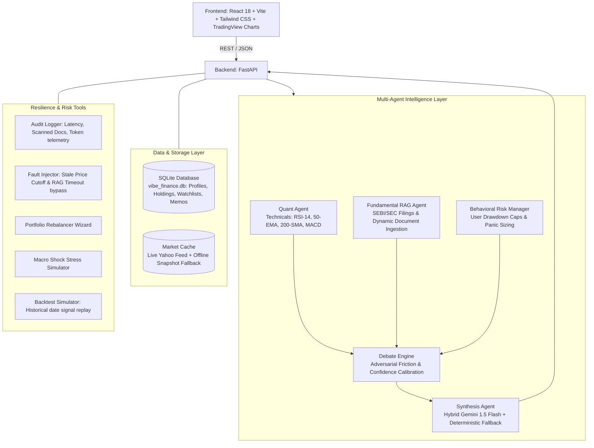

# Vibe Finance - Multi-Agent Investment Intelligence Platform

A high-performance, personalized multi-agent financial intelligence system designed for retail investors. It orchestrates specialized quantitative, fundamental, and behavioral risk agents to generate transparent, explainable, and risk-calibrated investment consensus.

---

## 🏛️ System Architecture



---

## 🚀 Key Capabilities

### 1. The Multi-Agent Intelligence Layer
* **Quant Agent:** Mathematical indicator engine running Wilder's RSI-14, 50-day EMA, 200-day SMA golden/death cross, MACD (line, signal, histogram), and volume anomaly ratio.
* **Fundamental RAG Agent:** Vector retrieval over parsed corporate filings (SEBI LODR, SEC 10-K, earnings calls) with real-time text chunking and polarity extraction. Isolated corpus prevents uncataloged ticker cross-contamination.
* **Behavioral Risk Manager:** Dynamically enforces portfolio drawdown bounds, calibrates panic-sell sensitivity, and caps high-beta exposure for conservative mandates.
* **Adversarial Debate Engine:** Detects agent friction (e.g. Bullish Quant vs Bearish RAG), runs multi-step adversarial cross-examination, and computes calibrated confidence scores.
* **Hybrid Gemini 1.5 Flash Synthesis:** Structured JSON LLM generation via Gemini 1.5 Flash with automatic fallback to a deterministic algorithmic engine for zero-dependency operation.

### 2. Interactive TradingView Candlestick Visualizer
* Full **TradingView Lightweight Charts** integration (`lightweight-charts` v5.2.1).
* Renders 30+ daily OHLCV candlestick bars and volume histograms with dynamic timeframe selectors (1M, 3M, 14D) and continuous organic volatility.

### 3. Voice Waveform Synthesis & Accessibility
* Multimodal browser speech synthesis with distinct voice personas for Quant (energetic), Fundamental RAG (measured British), and Behavioral Risk (protective).
* Real-time animated audio waveform visualizer responding to active speech synthesis playback.

### 4. Advanced Risk & Rebalancing Tools
* **Automated Portfolio Rebalancer Wizard:** Compares sector allocations against user risk bounds (`Conservative`, `Moderate`, `Aggressive`) and calculates exact share adjustments (TRIM / ACCUMULATE) with one-click rebalance execution.
* **Macro Stress Simulator:** Simulates historical market dislocations (2020 Liquidity Crash, 2022 Fed Rate Hikes, Global Energy Crisis), projecting instantaneous portfolio PnL impact and mitigation recommendations.
* **"What-If" Pre-Trade Behavioral Nudge:** Intercepts volatile orders for conservative users with visual before-and-after portfolio delta alerts (Tech concentration %, Portfolio Beta).

### 5. Persistent Storage & Dynamic Ingestion (SQLite)
* Persistent relational storage (`vibe_finance.db`) for:
  - User Risk Calibration Profiles (`/api/user-profile`)
  - Portfolio Holdings with real-time mark-to-market valuations (`/api/portfolio/holdings`)
  - Watchlists with price targets (`/api/watchlist`)
  - Exported Decision Memorandums (`/api/memos`)
* **Dynamic RAG Ingestion:** Interactive document uploader via `/api/rag/upload` enabling instant ingestion of arbitrary filings, press releases, or broker notes.

### 6. Resiliency & Graceful Degradation (Fault Injection)
* **Stale Live Price Feed Simulation:** Simulates feed dropouts, falls back to `STALE_FALLBACK_EOD`, and applies a 25-point confidence penalty.
* **RAG Timeout Handling:** Gracefully completes analysis using technical signals and risk constraints when regulatory filings timeout.

---

## ⚡ Quick Start

### 1. Environment Configuration
Copy the example configuration file:
```bash
cp .env.example .env
```
*(Optional: Add `GEMINI_API_KEY` for live generative LLM synthesis. If omitted, the platform runs seamlessly on its built-in deterministic engine.)*

### 2. Start the Backend (FastAPI)
```bash
cd backend
python -m uvicorn main:app --port 8000 --reload
```
Interactive API documentation: [http://localhost:8000/docs](http://localhost:8000/docs)

### 3. Start the Frontend (React + Vite)
In a separate terminal:
```bash
cd frontend
npm install
npm run dev
```
Open your browser at: [http://localhost:5173](http://localhost:5173)

---

## 🧪 Comprehensive Test Suite

Run the full end-to-end multi-agent test suite:
```bash
python -u backend/test_suite.py
```

### All 19 Test Scenarios Verified:
1. **Health Endpoint:** Degradation checks and live feed status.
2. **Tracked Equities:** Indian & US universe discovery.
3. **Multi-Agent Consensus:** Adversarial friction and action synthesis.
4. **Stale Data Degradation:** Feed fallback & confidence penalty.
5. **RAG Timeout Fallback:** Technical momentum fallback when vector DB times out.
6. **Pre-Trade Behavioral Nudge:** Risk boundary interception & delta calculation.
7. **Portfolio Valuation:** Beta, mark-to-market values, and concentration heatmap.
8. **Historical Backtest:** Signal replay against benchmark returns.
9. **Uncataloged Ticker Isolation:** Guaranteed 0 cross-contaminating citations.
10. **Input Validation:** Pydantic boundary validation (rejects negative trades).
11. **Database Auto-Seeding:** Initializing persistent holdings and user profile tables.
12. **User Profile Persistence:** Round-trip SQLite database reads and writes.
13. **Portfolio Holding CRUD:** Adding, updating, and removing positions.
14. **Watchlist & Decision Memos:** Relational memo persistence and querying.
15. **Mathematical Indicators:** Wilder's RSI(14), 50-EMA, 200-SMA, and MACD.
16. **Candlestick History:** 30-day OHLCV bar generation for TradingView charts.
17. **Dynamic Generalized Debate:** Dynamic adversarial synthesis on arbitrary tickers (e.g. AMD).
18. **Dynamic RAG Ingestion:** Instant chunking, polarity scoring, and citation indexing.
19. **Persistent SQLite REST Integration:** Verified profile and memo endpoints.
