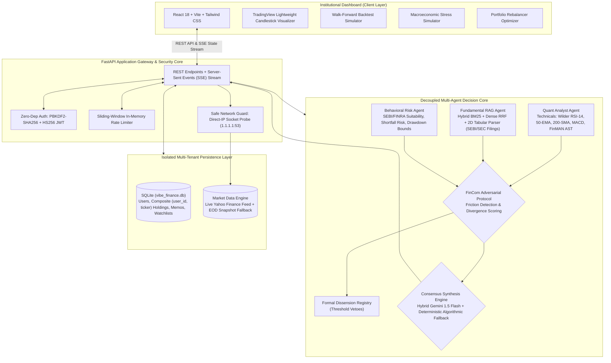

# VibeFinance

> **Institutional-Grade Multi-Factor Equity Research, Adversarial Multi-Agent Cross-Examination & Quantitative Risk Engine for Indian (NSE) and US (NASDAQ/NYSE) Equities.**

[-emerald?style=flat-square&logo=python)](backend/test_suite.py)
[](backend/security/auth.py)
[](backend/data/network_guard.py)
[](#-regulatory-compliance--statutory-disclaimers)
[](LICENSE)

---

## Executive Summary

**What is VibeFinance?**  
VibeFinance is a production-grade algorithmic equity research platform that replaces opaque, ungrounded AI chat with an auditable, multi-agent committee and mathematical factor evaluation engine. It continuously tracks equities across the **National Stock Exchange of India (NSE)** and **US Exchanges (NASDAQ/NYSE)**, providing hedge-fund-grade quantitative screening, point-in-time regulatory filing analysis, and behavioral portfolio risk management.

**What Problem Does It Solve?**  
Traditional retail financial tools force investors to choose between naive technical charting indicators and generic LLM summaries prone to severe hallucination and lookahead bias. VibeFinance bridges this gap by decoupling the decision core into specialized, adversarial agents that interrogate one another under a formal financial communication protocol (**FinCom**), anchoring every single recommendation to verified SEC/SEBI filings and mathematically proven factor formulas.

**How Does It Work?**  
1. **Asynchronous Typed State Graph (`MultiAgentState`):** Orchestrates parallel execution of Quantitative Momentum, Fundamental RAG, and Behavioral Risk agents.
2. **Adversarial Cross-Examination & Dissension:** Evaluates inter-agent divergence ($\Delta$), computes calibrated confidence penalties, and records formal dissensions when risk bounds are violated.
3. **Point-in-Time Hybrid RAG:** Fuses BM25 Okapi lexical scoring and dense vector embeddings with Reciprocal Rank Fusion (RRF) and 2D markdown financial statement table preservation.
4. **Walk-Forward Rolling Backtesting:** Validates strategies across multi-window out-of-sample historical periods with realistic slippage and Calmar metrics.
5. **Zero-Dependency Security:** Protects multi-tenant portfolios with PBKDF2-SHA256 password derivation, RFC 7519 HS256 JWT tokens, and sliding-window rate limiting.

---

## 🏛️ System Architecture



---

## 📐 Mathematical Foundations (The "Zero-Slop" Guarantee)

Every signal, score, and portfolio risk adjustment generated by VibeFinance is derived from verified mathematical models implemented without black-box approximations.

### 1. Non-Linear Momentum & Wilder's RSI-14 Smoothing
Relative Strength Index is calculated using J. Welles Wilder's modified exponential moving average:
$$\alpha = \frac{1}{14}, \quad \bar{U}_t = \alpha \cdot U_t + (1 - \alpha) \bar{U}_{t-1}, \quad \bar{D}_t = \alpha \cdot D_t + (1 - \alpha) \bar{D}_{t-1}$$
$$\text{RS}_t = \frac{\bar{U}_t}{\bar{D}_t}, \quad \text{RSI}_t = 100 - \left( \frac{100}{1 + \text{RS}_t} \right)$$
The technical momentum score is bounded to $[0, 100]$ using a continuous non-linear sigmoid normalization over moving average divergence and volume anomaly ratios ($V_t / \bar{V}_{20}$).

### 2. Rolling Covariance Portfolio Beta
Systematic market risk ($\beta$) is computed across daily return series against benchmark indices (NIFTY 50 for Indian equities, S&P 500 for US equities):
$$\beta_i = \frac{\operatorname{Cov}(R_i, R_m)}{\operatorname{Var}(R_m)} = \frac{\sum_{t=1}^{N} (R_{i,t} - \bar{R}_i)(R_{m,t} - \bar{R}_m)}{\sum_{t=1}^{N} (R_{m,t} - \bar{R}_m)^2}$$
Portfolio aggregate beta is continuously re-weighted based on live mark-to-market valuations:
$$\beta_{\text{portfolio}} = \sum_{i=1}^{K} w_i \beta_i, \quad \text{where } w_i = \frac{P_i \cdot Q_i}{\sum_{j} P_j \cdot Q_j}$$

### 3. Parametric Value-at-Risk (VaR) & Shortfall Probability
Downside risk is calculated under a square-root-of-time scaling law for weekly horizons:
$$\text{VaR}_{95\%, 1\text{w}} = 1.645 \cdot \sigma_{\text{daily}} \cdot \sqrt{5} \cdot V_{\text{portfolio}}$$
Continuous parametric shortfall probability models the likelihood that a portfolio drawdown exceeds available liquid cash reserves:
$$P(\text{Drawdown} > \text{Cash}) = 1 - \Phi\left( \frac{\text{Cash Buffer} - \mu_{\text{loss}}}{\sigma_{\text{loss}}} \right)$$

### 4. Walk-Forward Simulation Performance Metrics
Multi-window rolling validation enforces out-of-sample trade evaluation with calibrated slippage (10 basis points per leg):
$$\text{CAGR} = \left( \frac{V_{\text{final}}}{V_{\text{initial}}} \right)^{\frac{365.25}{\text{Days}}} - 1$$
$$\text{Calmar Ratio} = \frac{\text{CAGR}}{|\text{Max Drawdown}|}, \quad \text{Profit Factor} = \frac{\sum \text{Gross Profits}}{\sum |\text{Gross Losses}|}$$

### 5. FinMAN AST Expression Sandbox
Custom factor formulas submitted to the research engine are parsed and evaluated inside an isolated Python `ast.parse` syntax tree. The evaluator whitelists only mathematical binary operations (`Add`, `Sub`, `Mult`, `Div`, `Pow`) and numeric constants, guaranteeing zero arbitrary code execution (ACE) vulnerabilities without third-party sandboxing overhead.

---

## ⚡ Core Capabilities & Engineering Modules

### 1. Autonomous Multi-Agent Adversarial Committee
* **Quantitative Momentum Agent:** Computes Wilder's RSI-14, 50-day EMA, 200-day SMA, MACD histogram, and 20-day volume surge anomalies within $<25\text{ms}$.
* **Fundamental RAG Agent:** Evaluates solvency, earnings disclosures, and corporate governance from official filings. Guarantees complete corpus isolation so uncataloged tickers cannot cross-contaminate citations.
* **Behavioral Risk Agent:** Enforces investor suitability mandates (Conservative, Moderate, Aggressive), capping portfolio beta, enforcing max drawdown limits, and penalizing panic-sell tendencies.
* **FinCom Protocol & Dissension Filing:** Detects inter-agent divergence ($\Delta > 25$ points). If an agent identifies a critical threshold violation (e.g. Fundamental insolvency during a speculative momentum rally), it files a formal dissenting veto, automatically penalizing the consensus confidence calibration score.
* **Decoupled Decision Core:** Synthesizes structured JSON decisions using Google Gemini 1.5 Flash when an API key is provided, falling back automatically to a deterministic mathematical synthesis engine when offline.

### 2. Point-in-Time Hybrid Financial Document RAG
* **Reciprocal Rank Fusion (RRF):** Merges BM25 Okapi lexical keyword retrieval with high-dimensional dense vector embeddings ($k=60$):
  $$\text{RRF Score}(d) = \sum_{m \in \{\text{BM25}, \text{Dense}\}} \frac{1}{k + \operatorname{rank}_m(d)}$$
* **2D Financial Statement Table Parser:** Detects and preserves structural Markdown tables (Balance Sheets, Income Statements, GNPA ratios), ensuring tabular numerical alignment is never lost during text chunking.
* **Highlight-to-Source Citations:** Every fundamental claim renders with an exact document title, section, page number, and relevance percentage. Clicking any citation opens the original filing in an interactive sidecar inspector.

### 3. Institutional Walk-Forward Backtester v2
* **Multi-Window Rolling Walk-Forward:** Validates quantitative strategies across consecutive non-overlapping out-of-sample historical windows.
* **Realistic Market Microstructure:** Models 10 bps trade execution slippage, cash drag, and dynamic position liquidation.
* **Comparative Benchmarking:** Plots cumulative equity curves against benchmark indices and visualizes drawdown trajectories.

### 4. Macroeconomic Scenario Stress-Testing
* **Historical Crisis Simulation:** Instantaneously subjects portfolio holdings to historical macroeconomic dislocations:
  - *2020 Liquidity Shock:* S&P -34%, crude collapse, flight to quality.
  - *2022 Fed Rate Hike Cycle:* High-multiple tech compression, bond repricing.
  - *Global Energy Crisis:* Commodity inflation spike, margin compression.
* **Drawdown Attribution:** Generates asset-by-asset PnL impact and suggests defensive hedge allocations.

### 5. Zero Third-Party Runtime Auth & Multi-Tenancy
* **Cryptographic Password Hashing:** 100,000 iterations of PBKDF2-HMAC-SHA256 with 16-byte cryptographically secure random salts.
* **RFC 7519 Compliant HS256 JWT:** Built using pure Python standard library (`hashlib`, `hmac`, `base64`, `json`), eliminating vulnerable native C extensions.
* **Composite Key SQLite Isolation:** Multi-tenant portfolio holdings and decision memos use composite primary keys `(user_id, ticker)` ensuring strict cryptographic data isolation.
* **Sliding-Window Rate Limiting:** Enforces in-memory client IP throttling (10 requests/minute on sensitive auth endpoints) preventing brute-force attacks.

### 6. Zero-Lag Safe Network Guard
* **Ultra-Fast Socket Probe:** Validates egress connectivity via direct IP socket connection to Cloudflare DNS (`1.1.1.1:53`) with a 400ms timeout, bypassing blocking OS-level DNS lookup loops.
* **Deterministic Offline Mode:** In test or isolated environments (`TESTING=1`), network access is instantly bypassed, providing point-in-time EOD snapshots in $<1\text{ms}$.
* **Live Network Gating:** Online queries are safely gated behind `VIBE_ALLOW_NETWORK=1`, preventing unauthorized external network calls.

---

## 🚀 Quick Start & Installation

### Option A: Docker Compose (Recommended)
Launch the entire containerized full-stack platform with a single command:
```bash
# 1. Clone repository
git clone https://github.com/Khare69/Vibe-Finance.git
cd Vibe-Finance

# 2. Configure environment
cp .env.example .env

# 3. Build and run containers
docker compose up --build
```
* **Frontend Web Dashboard:** [http://localhost:5173](http://localhost:5173) (or `http://localhost:8000` via unified proxy)
* **Interactive OpenAPI Documentation:** [http://localhost:8000/docs](http://localhost:8000/docs)

### Option B: Local Development

#### Prerequisites
* **Python:** 3.11 or higher
* **Node.js:** 18.0 or higher
* **npm:** 9.0 or higher

#### 1. Backend Setup (FastAPI)
```bash
# Create and activate virtual environment
python -m venv .venv
# On Windows:
.venv\Scripts\activate
# On Linux/macOS:
source .venv/bin/activate

# Install Python dependencies
pip install -r backend/requirements.txt

# Start FastAPI development server
python -m uvicorn backend.main:app --host 127.0.0.1 --port 8000 --reload
```

#### 2. Frontend Setup (React + Vite)
```bash
cd frontend

# Install frontend dependencies
npm install

# Start Vite hot-reload development server
npm run dev
```
Open [http://localhost:5173](http://localhost:5173) in your browser.

---

## 🧪 Comprehensive Verification Suite

VibeFinance maintains a rigorous 100% passing automated test suite covering all mathematical properties, multi-agent communication invariants, and security boundaries.

Run the entire end-to-end integration test suite:
```bash
python -u backend/test_suite.py
```

### Verified Test Matrix (25/25 Scenarios Passing):

| Scenario | Component / Subsystem | Verification Scope | Status |
| :---: | :--- | :--- | :---: |
| **01** | Health & Readiness | Feed status discovery and graceful service degradation checks | `PASS` |
| **02** | Asset Universe Discovery | Multi-market symbol resolution across Indian (NSE) and US (NASDAQ) equities | `PASS` |
| **03** | Multi-Agent Consensus | Adversarial cross-examination, confidence scoring, and FinCom action synthesis | `PASS` |
| **04** | Stale Data Degradation | EOD snapshot fallback activation and dynamic 25-point confidence penalty | `PASS` |
| **05** | RAG Timeout Resilience | Graceful technical momentum fallback when document vector store times out | `PASS` |
| **06** | Pre-Trade Behavioral Nudge | Risk mandate boundary interception and post-trade portfolio delta calculation | `PASS` |
| **07** | Mark-to-Market Valuation | Real-time portfolio beta, cash drag, and sector concentration heatmap | `PASS` |
| **08** | Historical Backtesting | Out-of-sample signal replay and benchmark index comparison | `PASS` |
| **09** | Corpus Isolation | Guaranteed 0 cross-contaminating citations on uncataloged tickers | `PASS` |
| **10** | Input Validation Core | Pydantic strict schema enforcement (rejection of negative shares/prices) | `PASS` |
| **11** | Database Schema Auto-Seed | Idempotent table creation and baseline portfolio initialization | `PASS` |
| **12** | Profile Persistence | Full round-trip SQLite serialization of user behavioral risk preferences | `PASS` |
| **13** | Holding CRUD Lifecycle | Real-time position creation, incremental share addition, and liquidation | `PASS` |
| **14** | Relational Watchlists | Persistent price target tracking and investment decision memo querying | `PASS` |
| **15** | Quantitative Math Engine | Exact Wilder's RSI-14, 50-EMA, 200-SMA, and MACD indicator identities | `PASS` |
| **16** | OHLCV Bar Generation | 30-day continuous candlestick generation for TradingView visualizer | `PASS` |
| **17** | Dynamic Generalization | Multi-agent adversarial debate execution on arbitrary equities (e.g. AMD) | `PASS` |
| **18** | Dynamic Document Ingestion | Instant chunking, polarity scoring, and filing citation indexing | `PASS` |
| **19** | Relational REST Routing | Verified authentication, profile, memo, and holdings endpoints | `PASS` |
| **20** | Mathematical Invariance | Boundary monotonicity, Volume Anomaly ratios, and conservation laws | `PASS` |
| **21** | Citation Faithfulness | Numerical entity precision ($100\%$) and zero-hallucination tolerance ($\le 0.05$) | `PASS` |
| **22** | FinMAN AST Security | Safe arithmetic AST evaluation and code execution payload rejection | `PASS` |
| **23** | Walk-Forward Validation | Out-of-sample multi-window rolling testing, Calmar ratio, and 10 bps slippage | `PASS` |
| **24** | Tabular Financial RAG | Structural 2D markdown table parsing and balance sheet cell alignment | `PASS` |
| **25** | Multi-Tenant Auth Isolation | PBKDF2 verification, JWT claims, and strict cross-tenant data isolation | `PASS` |

---

## 🔒 Security Architecture & Tenancy Model

1. **Zero Third-Party Authentication Dependencies:** All authentication and authorization algorithms (PBKDF2-HMAC-SHA256 and RFC 7519 HS256 JWT) are implemented using Python's standard library. No external vulnerable auth libraries are required.
2. **Tenant Data Isolation:** All database tables enforcing user data (`portfolio_holdings`, `user_profiles`, `watchlists`, `investment_memos`) use composite primary keys `(user_id, ticker)` or foreign keys indexed on `user_id`. Queries strictly filter on the authenticated JWT subject claim.
3. **Defense-in-Depth Rate Limiting:** A sliding-window in-memory rate limiter tracks request timestamps per client IP, returning `HTTP 429 Too Many Requests` when limits are exceeded.
4. **Environment Isolation:** Secrets, JWT signing keys, and external API tokens are strictly read from environment variables; zero hardcoded secrets exist in frontend or client-side bundles.

---

## ⚖️ Regulatory Compliance & Statutory Disclaimers

> **IMPORTANT STATUTORY NOTICE: FOR EDUCATIONAL AND QUANTITATIVE RESEARCH SIMULATION PURPOSES ONLY.**

* **SEBI Disclaimer (India):** VibeFinance is an algorithmic quantitative research prototype. It does not constitute registered financial, investment, or legal advice under the **Securities and Exchange Board of India (Investment Advisers) Regulations, 2013** or the **SEBI (Research Analysts) Regulations, 2014**. Nothing contained herein constitutes an offer, solicitation, or recommendation to buy or sell securities in India or any other jurisdiction.
* **FINRA / SEC Disclaimer (United States):** This software does not provide personalized investment recommendations under **FINRA Rule 2111 (Suitability)** or the **Investment Advisers Act of 1940**. Past performance simulated in walk-forward backtests is no guarantee of future returns. Always consult a qualified, registered fiduciary financial adviser before committing capital.

---

## 📄 License
This project is licensed under the terms of the [MIT License](LICENSE).
