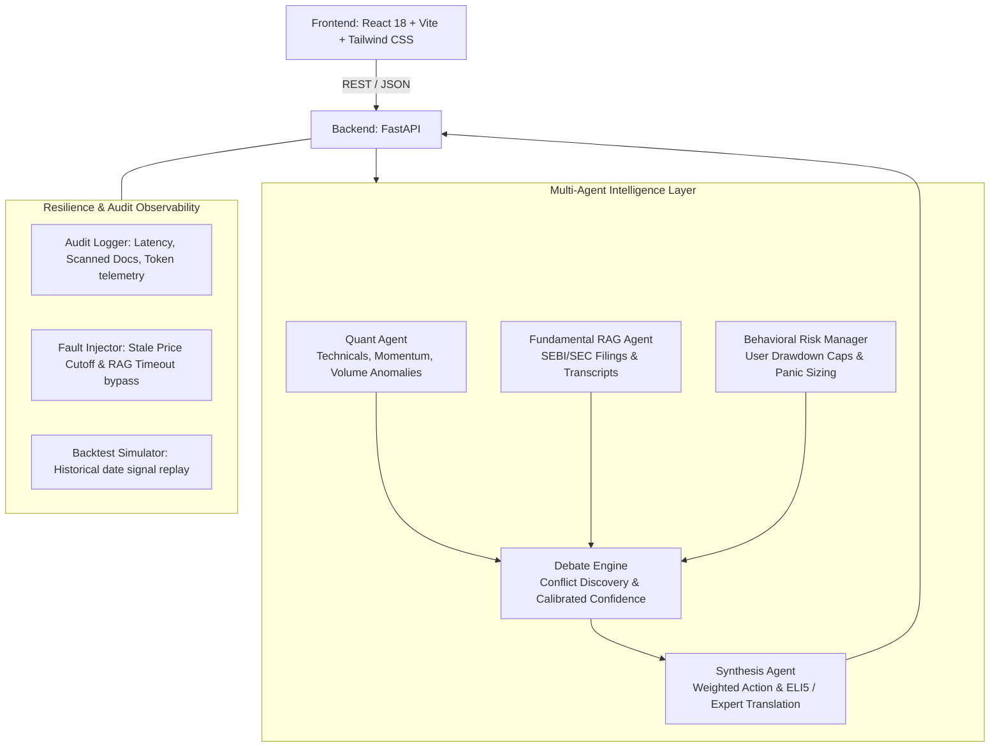

# Vibe Finance - Multi-Agent Investment Intelligence Platform

A high-performance, personalized multi-agent financial intelligence system designed for retail investors. It orchestrates specialized quantitative, fundamental, and behavioral risk agents to generate transparent, explainable, and risk-calibrated investment consensus.

---

## 🏛️ System Architecture



---

## 🚀 Key Features

### 1. The Multi-Agent "Team" & Adversarial Debate
* **Quant Agent:** Technical momentum, RSI(14), 50-EMA vs 200-SMA golden/death cross, MACD expansion, and 20-day volume surge detection.
* **Fundamental RAG Agent:** Deep document search over parsed corporate filings (SEBI LODR, SEC Form 10-K, earnings call transcripts) flagging debt capex spikes and retail margin compression.
* **Behavioral Risk Manager:** Maps user risk profiles (Conservative, Moderate, Aggressive), panic-sell propensity, and caps high-volatility allocations.
* **Agent Debate Engine:** Automatically identifies when agents disagree (e.g. Bullish Quant vs Bearish RAG), runs a multi-turn adversarial dialogue, and calibrates confidence (e.g. 63% on conflict vs 84% on alignment).

### 2. Deep Personalization & Behavioral Nudges
* **Interactive "Vibe Check" Onboarding:** Scenario-based stress test ("What if your portfolio drops 10% in a week?") + continuous risk slider.
* **"What-If" Pre-Trade Behavioral Nudge:** Intercepts volatile orders for conservative users with visual before-and-after portfolio delta alerts (Tech concentration %, Portfolio Beta).

### 3. RAG & Document Intelligence
* **Highlight-to-Source Tracing:** Clickable citation footnotes open the exact paragraph in the SEC/SEBI filing with an illuminated yellow highlight.
* **Quarter-over-Quarter Sentiment Shift Timeline:** Tone drift and keyword frequency comparison (`headwinds`, `capex`, `margin pressure`, `robust demand`) between Q2 and Q3.

### 4. Interactive Dashboard & Explainability
* **"Why This, Why Now?" Attribution Panel:** Visual weight breakdown (Technicals %, Fundamentals %, Risk Profile %).
* **ELI5 / Beginner Toggle:** Switches between plain English everyday analogies and institutional financial analysis.
* **Portfolio Risk Heatmap:** Concentration matrix showing sector exposures and portfolio Beta.

### 5. Resiliency & Graceful Degradation (Fault Injection)
* **Stale Live Price Feed Simulation:** Simulates feed interruption, falls back to `STALE_FALLBACK_EOD`, and applies a confidence penalty.
* **RAG Timeout Handling:** Gracefully completes analysis using technical signals only when filing retrieval times out.

### 6. Observability & Backtesting
* **Developer View / Session Audit Drawer:** Live per-agent latency waterfalls (`quant_ms`, `rag_ms`, `risk_ms`), vector search retrieval duration, and raw JSON telemetry inspector.
* **Historical Backtesting Simulator:** Replays past agent recommendations on historical dates and validates against actual forward returns.

---

## ⚡ Quick Start

### 1. Start the Backend (FastAPI)
```bash
cd backend
python -m uvicorn main:app --port 8000 --reload
```
API Documentation will be live at: [http://localhost:8000/docs](http://localhost:8000/docs)

### 2. Start the Frontend (React + Vite)
In a separate terminal:
```bash
cd frontend
npm run dev
```
Open your browser at: [http://localhost:5173](http://localhost:5173)

---

## 🧪 Run Backend Test Suite
```bash
python -u backend/test_suite.py
```
Validates all 8 core test scenarios:
1. Health check & corpus validation
2. Stocks directory listing
3. Multi-agent conflict & consensus resolution
4. Stale data degradation fallback
5. RAG timeout degradation handling
6. Pre-trade behavioral nudge & portfolio delta calculation
7. Portfolio valuation & concentration heatmap
8. Historical backtesting simulation
