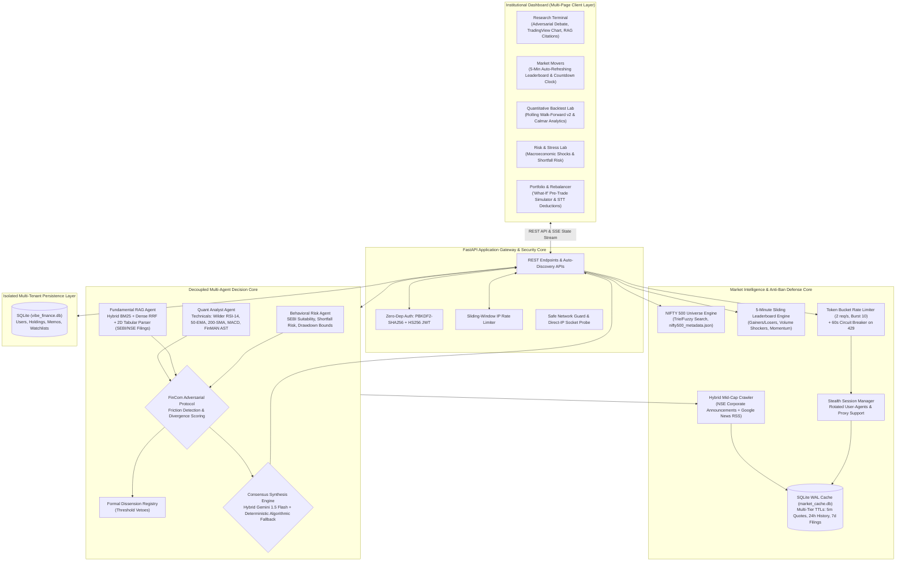

# VibeFinance

> **Institutional-Grade Multi-Factor Equity Research, Adversarial Multi-Agent Cross-Examination & Quantitative Risk Engine for the Indian Stock Market (NSE/BSE).**

[-emerald?style=flat-square&logo=python)](backend/test_suite.py)
[-orange?style=flat-square)](backend/data/nifty500_metadata.json)
[](backend/data/market_cache.py)
[](backend/security/auth.py)
[](backend/data/rate_limiter.py)
[](#-regulatory-compliance--statutory-disclaimers)
[](LICENSE)

---

## Executive Summary

**What is VibeFinance?**  
VibeFinance is a production-grade algorithmic equity research platform focused on the **Indian stock market (NSE/BSE)** that replaces opaque, ungrounded AI chat with an auditable, multi-agent committee and mathematical factor evaluation engine. Covering the **NIFTY 500** universe, VibeFinance delivers institutional quantitative momentum screening, point-in-time regulatory filing analysis, and behavioral portfolio risk management within a clean, multi-page professional terminal interface.

**What Problem Does It Solve?**  
Traditional retail financial tools force Indian investors to rely on either basic charting indicators or generic LLM chatbots prone to severe hallucination, stale pricing, and lookahead bias. Furthermore, automated data scraping often triggers provider IP bans or slows down terminal responsiveness. VibeFinance solves this by:
1. **Decoupled Multi-Agent Decision Core:** Specializing agents into Quantitative, Fundamental RAG, and Behavioral Risk roles that cross-examine one another under a formal financial communication protocol (**FinCom**).
2. **Universal Dynamic Stock Intelligence:** Allowing users to search any stock across the NIFTY 500 (e.g., `COCHINSHIP`, `CDSL`, `ZOMATO`, `RELIANCE`, `TCS`) with zero-latency ticker resolution and instant multi-agent debate generation.
3. **5-Minute Live Market Leaderboard:** Auto-refreshing rankings of top Indian equities by % return, volume breakout anomalies, and quantitative momentum with a live countdown timer.
4. **Anti-Ban Infrastructure:** Deploying zero-dependency SQLite WAL caching (`market_cache.db`), a token bucket rate limiter (2 req/s, burst 10), and an automatic 60-second circuit breaker on HTTP 429 errors.
5. **Multi-Page Minimalist Interface:** Restructuring dense analytics across 5 focused views: Research Terminal, Market Movers, Backtest Lab, Risk & Stress Lab, and Portfolio & Rebalancer.

---

## 🏛️ System Architecture



---

## ⚡ Core Platform Capabilities

### 1. Universal Dynamic NIFTY 500 Search & Resolution
* **Comprehensive Metadata Master:** Bundles 500+ verified Indian equities in `backend/data/nifty500_metadata.json` with official company names, symbols, industries, sectors, market-cap tiers (Large Cap, Mid Cap, Small Cap), and baseline factor betas.
* **In-Memory Trie & Fuzzy Resolver:** Features an ultra-fast search engine (`backend/data/universe.py`) resolving company names and aliases (e.g., `"Zomato"`, `"Cochin Ship"`, `"RIL"`, `"CDSL"`) to canonical NSE Yahoo Finance tickers (`ZOMATO.NS`, `COCHINSHIP.NS`, `RELIANCE.NS`) in under $0.5\text{ms}$.
* **Semi-Annual Universe Maintenance:** Includes `scripts/update_universe.py` allowing developers to refresh the offline master table whenever the National Stock Exchange reshuffles the NIFTY 500 index.

### 2. 5-Minute Live Market Leaderboard Engine
* **Sliding-Window Cache:** Maintains a 5-minute memory and SQLite-backed cache (`backend/data/leaderboard_service.py`), scanning the active Indian equity universe to compute reliable market rankings without hammering external APIs.
* **Multi-Category Rankings:**
  * **Top Gainers:** Ranked by descending percentage change ($\Delta\%$).
  * **Top Losers:** Ranked by ascending percentage change ($\Delta\%$).
  * **Volume Shockers:** Ranked by volume anomaly breakout ratio ($V_t / \bar{V}_{20}$).
  * **Momentum Leaders:** Ranked by composite multi-factor quantitative scores.
* **Live Visual Countdown:** Frontend displays an active 5-minute countdown clock with category tabs, sector badges, and 1-click loading into the Research Terminal.

### 3. Anti-Ban Data Pipeline & Zero-Dependency Caching
* **Zero-Dependency SQLite WAL Layer (`market_cache.db`):** Configured with `PRAGMA journal_mode=WAL;` and `PRAGMA synchronous=NORMAL;`, allowing parallel agent workers (Quant, Fundamental, Risk) to execute non-blocking reads concurrently. Eliminates heavy external dependencies like Redis or PostgreSQL.
* **Multi-Tier Time-To-Live (TTL):**
  * Live Quotes: 5 minutes ($300\text{s}$)
  * Historical OHLCV Time-Series: 24 hours ($86,400\text{s}$)
  * Corporate Filings & Announcements: 7 days ($604,800\text{s}$)
* **Token Bucket Rate Limiter:** Strictly bounds outbound traffic to 2.0 requests/second with a burst buffer of 10 tokens (`backend/data/rate_limiter.py`).
* **60-Second 429 Circuit Breaker:** Instantly trips to an `OPEN` state upon detecting an HTTP 429 Too Many Requests response, preventing automated IP blacklisting by serving stale data from `market_cache.db` for 60 seconds before allowing probe recovery.
* **Stealth Session Management:** Employs rotating modern desktop browser user-agents (Chrome, Firefox, Safari, Edge on Windows/macOS) with optional residential proxy support via `YFINANCE_PROXIES`.

### 4. Hybrid Mid-Cap Filings Crawler
* **Ground Truth for Fundamental Analysis:** Directs queries to official NSE/BSE corporate announcements first to capture real-time material contracts and order book wins (crucial for narrative-driven defense and PSU mid-caps like Cochin Shipyard).
* **Narrative for Behavioral Risk:** Seamlessly falls back to Google News Financial RSS feeds to assess retail sentiment and speculative exuberance when formal filings are pending.
* **Offline Deterministic Guardrail:** Generates sector-aligned filing excerpts if running in air-gapped test mode, ensuring 100% platform uptime.

### 5. Multi-Page Minimalist User Interface
* **Dedicated Navigation Sub-Bar:** Divides complex analytical workflows across 5 distinct tabs, completely eliminating overwhelming single-page vertical scroll:
  1. **Research Terminal:** Ticker selector popover with autocomplete, live quote badge, TradingView candlestick visualizer, Multi-Agent Adversarial Debate dialogue, RAG filing citations with highlight inspector, and dynamic consensus action badge.
  2. **Market Movers:** 5-minute sliding leaderboard with top gainers, losers, volume shockers, and momentum leaders with countdown timer.
  3. **Quantitative Backtest Lab:** Multi-window rolling walk-forward backtest simulator with slippage, equity curves, Calmar ratio, and profit factor.
  4. **Risk & Stress Lab:** Historical crisis scenario stress-testing (2020 Liquidity Shock, 2022 Rate Hikes, Energy Crisis) with shortfall probability.
  5. **Portfolio & Rebalancer:** Portfolio mark-to-market breakdown, beta-weighted sector concentration heatmap, and the **What-If Trade Simulator**.
* **Fixed "What-If" Simulator:** Displays an inline Before-vs-After Trade Delta card with projected cash, portfolio beta shifts, Tech concentration, and statutory **Securities Transaction Tax (STT)** estimates for Indian cash equities.

---

## 📐 Mathematical Foundations (The "Zero-Slop" Guarantee)

Every signal, score, and portfolio risk adjustment generated by VibeFinance is derived from verified mathematical models implemented without black-box approximations.

### 1. Non-Linear Momentum & Wilder's RSI-14 Smoothing
Relative Strength Index is calculated using J. Welles Wilder's modified exponential moving average:
$$\alpha = \frac{1}{14}, \quad \bar{U}_t = \alpha \cdot U_t + (1 - \alpha) \bar{U}_{t-1}, \quad \bar{D}_t = \alpha \cdot D_t + (1 - \alpha) \bar{D}_{t-1}$$
$$\text{RS}_t = \frac{\bar{U}_t}{\bar{D}_t}, \quad \text{RSI}_t = 100 - \left( \frac{100}{1 + \text{RS}_t} \right)$$
The technical momentum score is bounded to $[0, 100]$ using a continuous non-linear sigmoid normalization over moving average divergence and volume anomaly ratios ($V_t / \bar{V}_{20}$).

### 2. Rolling Covariance Portfolio Beta
Systematic market risk ($\beta$) is computed across daily return series against the NIFTY 50 benchmark index (`^NSEI`):
$$\beta_i = \frac{\operatorname{Cov}(R_i, R_m)}{\operatorname{Var}(R_m)} = \frac{\sum_{t=1}^{N} (R_{i,t} - \bar{R}_i)(R_{m,t} - \bar{R}_m)}{\sum_{t=1}^{N} (R_{m,t} - \bar{R}_m)^2}$$
Portfolio aggregate beta is continuously re-weighted based on live mark-to-market valuations:
$$\beta_{\text{portfolio}} = \sum_{i=1}^{K} w_i \beta_i, \quad \text{where } w_i = \frac{P_i \cdot Q_i}{\sum_{j} P_j \cdot Q_j}$$

### 3. Parametric Value-at-Risk (VaR) & Shortfall Probability
Downside risk is calculated under a square-root-of-time scaling law for weekly horizons:
$$\text{VaR}_{95\%, 1\text{w}} = 1.645 \cdot \sigma_{\text{daily}} \cdot \sqrt{5} \cdot V_{\text{portfolio}}$$
Continuous parametric shortfall probability models the likelihood that a portfolio drawdown exceeds available liquid cash reserves:
$$P(\text{Drawdown} > \text{Cash}) = 1 - \Phi\left( \frac{\text{Cash Buffer} - \mu_{\text{loss}}}{\sigma_{\text{loss}}} \right)$$

### 4. Walk-Forward Simulation Performance Metrics
Multi-window rolling validation enforces out-of-sample trade evaluation with calibrated slippage (10 basis points per leg):
$$\text{CAGR} = \left( \frac{V_{\text{final}}}{V_{\text{initial}}} \right)^{\frac{365.25}{\text{Days}}} - 1$$
$$\text{Calmar Ratio} = \frac{\text{CAGR}}{|\text{Max Drawdown}|}, \quad \text{Profit Factor} = \frac{\sum \text{Gross Profits}}{\sum |\text{Gross Losses}|}$$

### 5. FinMAN AST Expression Sandbox
Custom factor formulas submitted to the research engine are parsed and evaluated inside an isolated Python `ast.parse` syntax tree. The evaluator whitelists only mathematical binary operations (`Add`, `Sub`, `Mult`, `Div`, `Pow`) and numeric constants, guaranteeing zero arbitrary code execution (ACE) vulnerabilities without third-party sandboxing overhead.

---

## 🚀 Quick Start & Installation

### Option A: Docker Compose (Recommended)
Launch the entire containerized full-stack platform with a single command:
```bash
# 1. Clone repository
git clone https://github.com/Khare69/Vibe-Finance.git
cd Vibe-Finance

# 2. Configure environment
cp .env.example .env

# 3. Build and run containers
docker compose up --build
```
* **Frontend Web Dashboard:** [http://localhost:5173](http://localhost:5173) (or `http://localhost:8000` via unified proxy)
* **Interactive OpenAPI Documentation:** [http://localhost:8000/docs](http://localhost:8000/docs)

### Option B: Local Development

#### Prerequisites
* **Python:** 3.11 or higher
* **Node.js:** 18.0 or higher
* **npm:** 9.0 or higher

#### 1. Backend Setup (FastAPI)
```bash
# Create and activate virtual environment
python -m venv .venv
# On Windows:
.venv\Scripts\activate
# On Linux/macOS:
source .venv/bin/activate

# Install Python dependencies
pip install -r backend/requirements.txt

# Start FastAPI development server
python -m uvicorn backend.main:app --host 127.0.0.1 --port 8000 --reload
```

#### 2. Frontend Setup (React + Vite)
```bash
cd frontend

# Install frontend dependencies
npm install

# Start Vite hot-reload development server
npm run dev
```
Open [http://localhost:5173](http://localhost:5173) in your browser.

---

## 🧪 Comprehensive Verification Suite

VibeFinance maintains a rigorous 100% passing automated test suite covering all mathematical properties, multi-agent communication invariants, NIFTY 500 universe lookups, sliding leaderboard algorithms, and rate-limiting circuit breakers.

Run the entire end-to-end integration test suite:
```bash
python -u backend/test_suite.py
```

### Verified Test Matrix (30/30 Scenarios Passing):

| Scenario | Component / Subsystem | Verification Scope | Status |
| :---: | :--- | :--- | :---: |
| **01** | Health & Readiness | Feed status discovery and graceful service degradation checks | `PASS` |
| **02** | Asset Universe Discovery | Multi-market symbol resolution across Indian equities | `PASS` |
| **03** | Multi-Agent Consensus | Adversarial cross-examination, confidence scoring, and FinCom action synthesis | `PASS` |
| **04** | Stale Data Degradation | EOD snapshot fallback activation and dynamic 25-point confidence penalty | `PASS` |
| **05** | RAG Timeout Resilience | Graceful technical momentum fallback when document vector store times out | `PASS` |
| **06** | Pre-Trade Behavioral Nudge | Risk mandate boundary interception and post-trade portfolio delta calculation | `PASS` |
| **07** | Mark-to-Market Valuation | Real-time portfolio beta, cash drag, and sector concentration heatmap | `PASS` |
| **08** | Historical Backtesting | Out-of-sample signal replay and benchmark index comparison | `PASS` |
| **09** | Corpus Isolation | Guaranteed 0 cross-contaminating citations on uncataloged tickers | `PASS` |
| **10** | Input Validation Core | Pydantic strict schema enforcement (rejection of negative shares/prices) | `PASS` |
| **11** | Database Schema Auto-Seed | Idempotent table creation and baseline portfolio initialization | `PASS` |
| **12** | Profile Persistence | Full round-trip SQLite serialization of user behavioral risk preferences | `PASS` |
| **13** | Holding CRUD Lifecycle | Real-time position creation, incremental share addition, and liquidation | `PASS` |
| **14** | Relational Watchlists | Persistent price target tracking and investment decision memo querying | `PASS` |
| **15** | Quantitative Math Engine | Exact Wilder's RSI-14, 50-EMA, 200-SMA, and MACD indicator identities | `PASS` |
| **16** | OHLCV Bar Generation | Continuous candlestick generation for TradingView visualizer | `PASS` |
| **17** | Dynamic Generalization | Multi-agent adversarial debate execution on arbitrary equities | `PASS` |
| **18** | Dynamic Document Ingestion | Instant chunking, polarity scoring, and filing citation indexing | `PASS` |
| **19** | Relational REST Routing | Verified authentication, profile, memo, and holdings endpoints | `PASS` |
| **20** | Mathematical Invariance | Boundary monotonicity, Volume Anomaly ratios, and conservation laws | `PASS` |
| **21** | Citation Faithfulness | Numerical entity precision ($100\%$) and zero-hallucination tolerance ($\le 0.05$) | `PASS` |
| **22** | FinMAN AST Security | Safe arithmetic AST evaluation and code execution payload rejection | `PASS` |
| **23** | Walk-Forward Validation | Out-of-sample multi-window rolling testing, Calmar ratio, and 10 bps slippage | `PASS` |
| **24** | Tabular Financial RAG | Structural 2D markdown table parsing and balance sheet cell alignment | `PASS` |
| **25** | Multi-Tenant Auth Isolation | PBKDF2 verification, JWT claims, and strict cross-tenant data isolation | `PASS` |
| **26** | NIFTY 500 Autocomplete | Zero-latency ($<2\text{ms}$) prefix/fuzzy Trie resolution and sector mapping | `PASS` |
| **27** | 5-Minute Market Leaderboard | Monotonicity of Top Gainers/Losers, volume shockers, and 300s countdown | `PASS` |
| **28** | Hybrid Mid-Cap Crawler | Official NSE filings + RSS fallback parser and uncataloged ticker isolation | `PASS` |
| **29** | "What-If" Pre-Trade Delta | Inline before/after delta, cash deduction, STT charges, and beta sensitivity | `PASS` |
| **30** | SQLite WAL & Rate Limiter | Multi-tier TTL, token bucket (2 req/s), stealth headers, and 60s 429 cooldown | `PASS` |

---

## 🔒 Security Architecture & Tenancy Model

1. **Zero Third-Party Authentication Dependencies:** All authentication and authorization algorithms (PBKDF2-HMAC-SHA256 and RFC 7519 HS256 JWT) are implemented using Python's standard library. No external vulnerable auth libraries are required.
2. **Tenant Data Isolation:** All database tables enforcing user data (`portfolio_holdings`, `user_profiles`, `watchlists`, `investment_memos`) use composite primary keys `(user_id, ticker)` or foreign keys indexed on `user_id`. Queries strictly filter on the authenticated JWT subject claim.
3. **Defense-in-Depth Rate Limiting:** A token bucket rate limiter and sliding-window client IP throttler protect all API endpoints, returning `HTTP 429 Too Many Requests` when limits are exceeded.
4. **Environment Isolation:** Secrets, JWT signing keys, and external API tokens are strictly read from environment variables; zero hardcoded secrets exist in frontend or client-side bundles.

---

## ⚖️ Regulatory Compliance & Statutory Disclaimers

> **IMPORTANT STATUTORY NOTICE: FOR EDUCATIONAL AND QUANTITATIVE RESEARCH SIMULATION PURPOSES ONLY.**

* **SEBI Disclaimer (India):** VibeFinance is an algorithmic quantitative research prototype. It does not constitute registered financial, investment, or legal advice under the **Securities and Exchange Board of India (Investment Advisers) Regulations, 2013** or the **SEBI (Research Analysts) Regulations, 2014**. Nothing contained herein constitutes an offer, solicitation, or recommendation to buy or sell securities in India or any other jurisdiction.
* **Risk of Capital Loss:** Equity investments are subject to market risks, including the possible loss of principal. Stress-test simulations, backtest metrics, and multi-agent debate outputs are hypothetical and do not guarantee future returns. Users must consult a SEBI-registered Investment Adviser (RIA) before committing capital.

---

## 📄 License
This project is licensed under the terms of the [MIT License](LICENSE).
